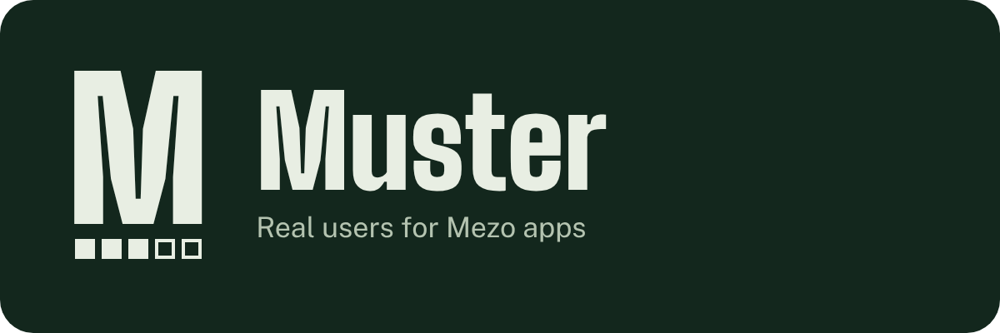
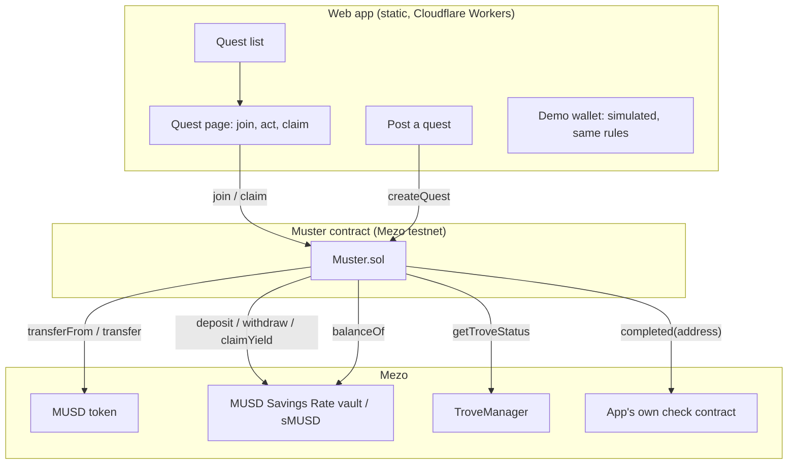
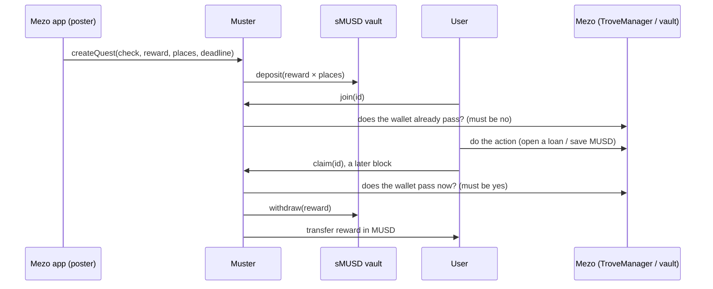
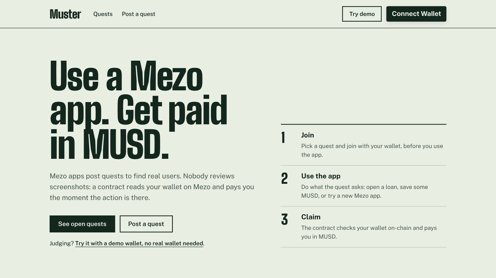
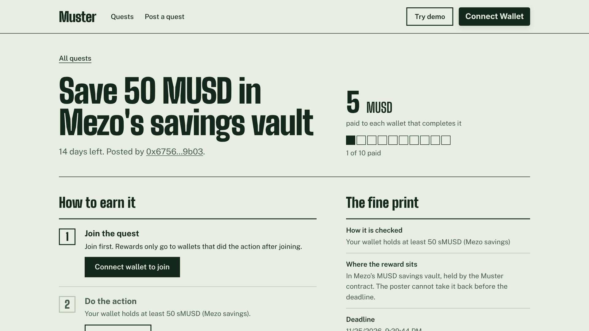
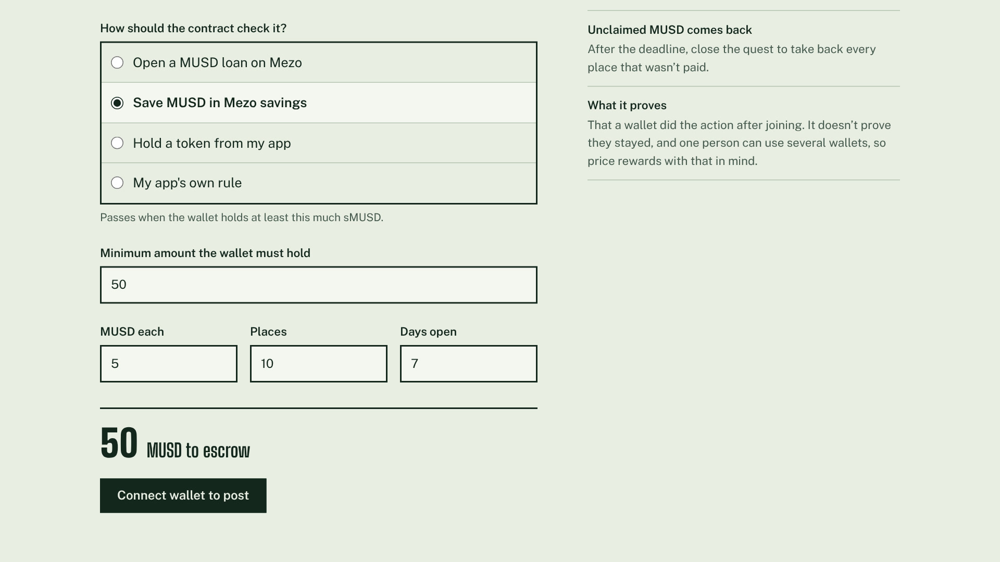
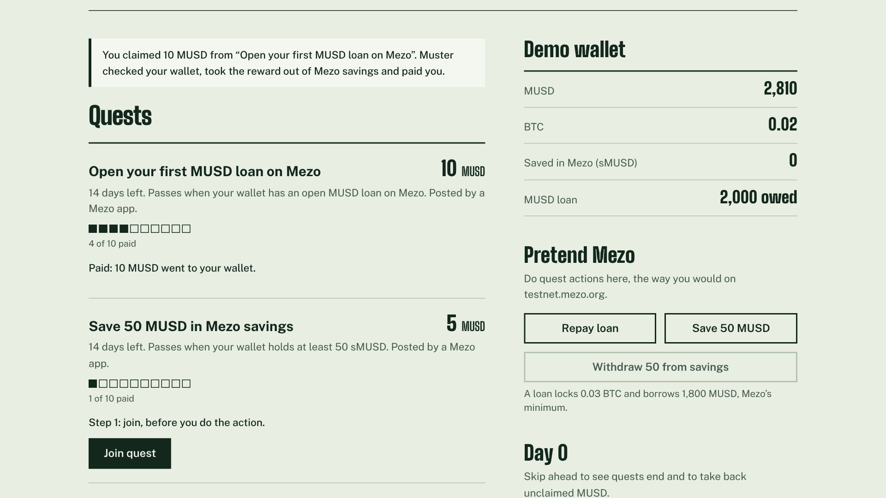
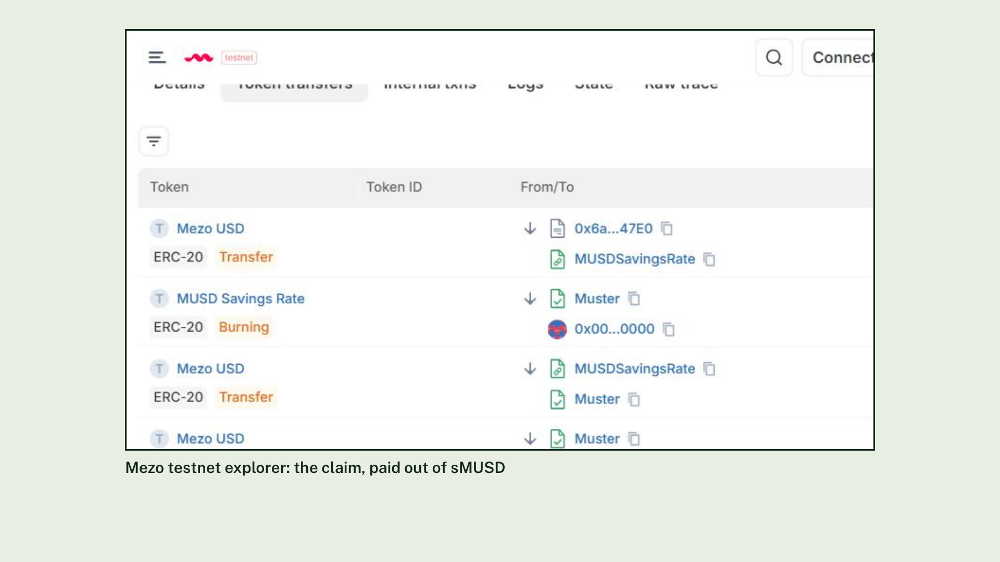

<div align="center">



### Real users for Mezo apps, paid in MUSD, proven on-chain.

Mezo apps post quests in MUSD. A user joins, does the action on Mezo, and claims.<br/>
The contract reads their wallet and pays them. No screenshots, no reviewers.

*To muster: to gather people for a purpose and count who showed up.*

[](https://muster.ahmardchain.workers.dev)
[](https://muster.ahmardchain.workers.dev/demo)
[](https://x.com/ahmardchain)

[](https://github.com/ahmardchain/Muster/actions/workflows/test.yml)


</div>

| | |
|---|---|
| **Live app** | [muster.ahmardchain.workers.dev](https://muster.ahmardchain.workers.dev) (quests load without a wallet) |
| **Demo wallet** | [/demo](https://muster.ahmardchain.workers.dev/demo): pretend MUSD, same rules as the contract |
| **Contract** | [`0x4639eA15F20DF8C35D1AD80EAA6E884182823fc4`](https://explorer.test.mezo.org/address/0x4639eA15F20DF8C35D1AD80EAA6E884182823fc4?tab=contract) (source verified) |
| **Network** | Mezo testnet, chain id 31611 |
| **Stack** | Solidity 0.8.28 · Hardhat · Next.js (static) · wagmi/viem · Mezo Passport · Cloudflare Workers |
| **Source** | this repo |

Built for **[Build with MUSD and MEZO](https://app.akindo.io/wave-hacks/ovoo0gdrvu8379d10)** (Mezo Buildathon on AKINDO), Wave 2, **Track 2: Access and Distribution**.

---

## Try it in 30 seconds

**No wallet:** open [/demo](https://muster.ahmardchain.workers.dev/demo), press **Start the demo**, then on *Open your first MUSD loan on Mezo*: **Join quest** → **Open a loan** (pretend Mezo) → **Claim 10 MUSD**. Post your own quest from the form below the list. Everything here is simulated in your browser and labelled as such.

**With a wallet on Mezo testnet:**
1. Get test BTC from the [Mezo faucet](https://faucet.test.mezo.org).
2. Open [*Borrow MUSD against your Bitcoin on Mezo*](https://muster.ahmardchain.workers.dev/quest?id=1) and press **Join quest**.
3. Open a MUSD loan on [testnet.mezo.org](https://testnet.mezo.org) with the same wallet.
4. Come back. The page re-checks your wallet every few seconds; press **Claim 5 MUSD**. The payout comes out of Mezo's savings vault.

**Verify in 2 minutes:** the [verified contract](https://explorer.test.mezo.org/address/0x4639eA15F20DF8C35D1AD80EAA6E884182823fc4?tab=contract) and the [claim transaction](https://explorer.test.mezo.org/tx/0x6a75775dcc36df2523860b83db94a46c7811e284fff8bedd7dbed880560fc3ab?tab=token_transfers), where sMUSD is burned and MUSD moves vault → Muster → wallet.

---

## Contents

- [The problem](#the-problem)
- [How it works](#how-it-works)
- [How MUSD and Mezo are used](#how-musd-and-mezo-are-used)
- [Architecture](#architecture)
- [Live proof](#live-proof)
- [Key design decision](#key-design-decision)
- [Screenshots](#screenshots)
- [What's real vs. simulated](#whats-real-vs-simulated)
- [Hackathon requirements and criteria](#hackathon-requirements-and-criteria)
- [Getting started](#getting-started)
- [Project structure](#project-structure)
- [Roadmap](#roadmap)

---

## The problem

In Wave 1 of this buildathon, the Mezo judge's most common note to teams was some version of *"every user so far is your own wallet."* By a rough count of the 135 judged Wave 1 entries, about a third were told to show users outside their own wallets.

New Mezo apps need first users they can point to. The usual tools (airdrop campaigns, quest platforms that pay for screenshots, form fills and follows) pay for things nobody can check, and they pay people who already used the app.

Muster pays only for actions that are visible on Mezo, and only for actions taken after the wallet joined:

- ✅ The check is a contract call, not a person reviewing proof
- ✅ Wallets that already qualify can't join, so apps pay for new usage
- ✅ The reward is escrowed up front, so users know it exists
- ✅ Idle escrow sits in Mezo's MUSD Savings Rate vault instead of doing nothing
- ✅ Every payout is a transaction anyone can open on the explorer

## How it works

| Step | Call | What the contract enforces |
|---|---|---|
| 📮 Post | `createQuest` | Pulls `reward × places` MUSD and deposits all of it into sMUSD; reverts if the vault credits less. Stores a title and link so users know what to do |
| 🙋 Join | `join` | Reverts if the wallet already passes the check |
| ⚙️ Act | *(on Mezo)* | The user opens a loan, saves MUSD, or uses the app. Muster is not involved |
| 💸 Claim | `claim` | At least one block after joining; not claimed before; check passes now. Withdraws the reward from sMUSD and pays it |
| 🔒 Close | `closeQuest` | Only the poster, only after the deadline. Unpaid places come back. Nobody can cancel early |
| 💰 Revenue | `sweep` | Sends savings yield to the treasury. Cannot move escrow |

**Checks a quest can use**

| Check | Passes when | Example |
|---|---|---|
| `TroveActive` | the wallet's trove status in Mezo's TroveManager is active | "Open your first MUSD loan" |
| `BalanceAtLeast` | the wallet holds at least *n* of a token | "Save 50 MUSD in Mezo savings" (sMUSD), hold an LP or receipt token |
| `Custom` | the app's contract returns `completed(address) == true` | any rule an app can express on-chain |

No owner, no upgrade, no pause. Posters pay no fee; Muster keeps the yield their escrow earns while it waits.

## How MUSD and Mezo are used

| Mezo piece | Address (testnet) | What Muster does with it |
|---|---|---|
| **MUSD** | `0x118917a40FAF1CD7a13dB0Ef56C86De7973Ac503` | The reward and the escrow |
| **MUSD Savings Rate (sMUSD)** | `0x6f461c68B2c5492C0F5CCEc5a264d692aA7A8e16` | All escrow is `deposit`ed on post and `withdraw`n on each claim or refund; `claimYield` funds the treasury; sMUSD balance is also a quest check |
| **TroveManager** | `0xE47c80e8c23f6B4A1aE41c34837a0599D5D16bb0` | `getTroveStatus` decides "has an open MUSD loan" quests |
| **Mezo Passport** | npm `@mezo-org/passport` | Wallet connection in the web app |

Engineering notes:
- The sMUSD vault is **not ERC-4626**. Read from its verified source: 1:1 shares, `deposit(uint256)`, `withdraw(uint256)` (which auto-claims yield to the caller), and `claimYield()`. Muster is written against that interface ([`IMUSDSavingsRate.sol`](contracts/interfaces/IMUSDSavingsRate.sol)).
- Because `withdraw` sends yield along with principal, Muster accounts escrow as `escrowed` (always equal to its sMUSD balance) and treats any extra MUSD as yield. Every test asserts that invariant.
- MUSD, TroveManager and sMUSD addresses were checked against [mezo-org/musd](https://github.com/mezo-org/musd) deployment artifacts and live calls; `musdToken()` and `yieldToken()` on the vault both return MUSD.

## Architecture





## Live proof

| What | Link |
|---|---|
| Contract, source verified | [explorer](https://explorer.test.mezo.org/address/0x4639eA15F20DF8C35D1AD80EAA6E884182823fc4?tab=contract) |
| Quest posted, 50 MUSD moved into sMUSD | [tx 0x19bc…efed](https://explorer.test.mezo.org/tx/0x19bc2f6f7c4600b8edaea28634c112ad63f837438f07536112b0fc00f177efed) |
| Wallet joined before acting | [tx 0xe53a…f0f0](https://explorer.test.mezo.org/tx/0xe53aee4a7cda8a1f8e00097e7c7c8408585c596d59ceb15147ba972a875ef0f0) |
| Wallet saved 50 MUSD on Mezo's own vault | [tx 0xd724…6744](https://explorer.test.mezo.org/tx/0xd72499f7e98305dcd8b962eccef3866339f08dba173c97097d744721188b6744) |
| Claim: sMUSD burned, 5 MUSD paid out | [tx 0x6a75…c3ab](https://explorer.test.mezo.org/tx/0x6a75775dcc36df2523860b83db94a46c7811e284fff8bedd7dbed880560fc3ab?tab=token_transfers) |
| **Second wallet**, full flow: join | [tx 0xf617…b12f](https://explorer.test.mezo.org/tx/0xf6179bb06f20d054e49bda4435100cc6043d035b9db02dadc0948e7155c9b12f) |
| Second wallet saves 50 MUSD on Mezo | [tx 0x04ea…c274](https://explorer.test.mezo.org/tx/0x04ea23341ca27794fee78c74edd5da0d7c373a321a3f5927436061398645c274) |
| Second wallet claims 5 MUSD | [tx 0x6d15…b3a0](https://explorer.test.mezo.org/tx/0x6d157d0f36c97eeec50d6a80676b1f2e470ea67a6c8c672d6eecac947538b3a0?tab=token_transfers) |

The live site's home page and `/demo` show the contract's current numbers: places paid, MUSD owed, and sMUSD held. The last two always match.

## Key design decision

**Pay only for actions taken after joining, and check it on-chain at both ends.**

A naive quest contract checks only at claim time:

- ❌ Anyone who already had a loan or savings claims instantly, so the app pays for users it already had.
- ❌ A screenshot or form field proves nothing and needs a person to review it.
- ❌ An escrow sitting in a contract earns nothing while it waits.

Muster checks twice. `join` refuses a wallet that already passes, and `claim` requires a later block, so a reward can only follow an action taken after joining:

```solidity
function join(uint256 id) external {
    Quest storage q = _quest(id);
    if (q.closed || block.timestamp > q.deadline || q.slotsLeft == 0) revert QuestOver();
    if (joinedAt[id][msg.sender] != 0) revert AlreadyJoined();
    if (_completed(q, msg.sender)) revert AlreadyQualifies();

    joinedAt[id][msg.sender] = block.number;
    emit Joined(id, msg.sender);
}
```

And every MUSD escrowed goes into Mezo savings, with a guard that the vault credited all of it:

```solidity
function _fund(uint256 total) private {
    escrowed += total;
    musd.safeTransferFrom(msg.sender, address(this), total);
    uint256 before = savings.balanceOf(address(this));
    musd.forceApprove(address(savings), total);
    savings.deposit(total);
    if (savings.balanceOf(address(this)) - before != total) revert SavingsMismatch();
}
```

External checks are gas-capped (200k) and wrapped in `try/catch`, so a broken or hostile check contract can only make its own quest unclaimable.

## Screenshots

| | |
|---|---|
|  **Home:** the pitch, the three steps, Try demo |  **Quest page:** reward, places paid, the check |
|  **Post a quest:** pick the check, reward and places |  **Demo wallet:** join, act on pretend Mezo, claim |
|  **A real claim** on the Mezo explorer: sMUSD burned, MUSD paid | |

## What's real vs. simulated

| | Status |
|---|---|
| Muster contract on Mezo testnet, source verified | ✅ Real |
| Escrow deposited into and withdrawn from Mezo's sMUSD vault | ✅ Real (see transactions above) |
| Trove and sMUSD checks against Mezo contracts | ✅ Real |
| Live site reading quests from the chain | ✅ Real |
| `/demo` demo wallet | 🛠️ Simulated in the browser, same rules as the contract, labelled on the page |
| Contract tests | 🛠️ Mocks shaped like the real sMUSD vault and TroveManager |
| Claims so far | Two test wallets, both the team's: the poster's wallet and a separate second wallet ([`0xDc7d…F639`](https://explorer.test.mezo.org/address/0xDc7d207a3197Fd7d880956770B9d0E606257F639)) |
| QR-code (WalletConnect) wallet connection | Not configured; browser and in-app wallets work |

## Hackathon requirements and criteria

| Requirement | How Muster meets it |
|---|---|
| Integrates MUSD and/or MEZO | MUSD is the reward and escrow; escrow lives in Mezo's sMUSD vault; quests read TroveManager and sMUSD |
| Working deployment on a supported chain | Mezo testnet, [verified contract](https://explorer.test.mezo.org/address/0x4639eA15F20DF8C35D1AD80EAA6E884182823fc4?tab=contract), [live app](https://muster.ahmardchain.workers.dev) |
| Built during the hackathon | Entirely new in Wave 2 |
| Extends MUSD utility | Turns MUSD into the currency apps use to acquire users, and routes that escrow into Mezo savings |
| Public GitHub repo | This repo, MIT licensed |

| Judging criterion (weight) | Where to look |
|---|---|
| Mezo integration (30%) | [How MUSD and Mezo are used](#how-musd-and-mezo-are-used), [`Muster.sol`](contracts/Muster.sol) |
| Product and business viability (30%) | [The problem](#the-problem); revenue is savings yield on idle escrow; posters pay no fee |
| Technical implementation (20%) | [Key design decision](#key-design-decision), 15 tests, no owner/upgrade/pause, gas-capped checks |
| User experience (10%) | No-wallet browsing, step-by-step quest page, plain-language errors, demo wallet |
| Submission materials (10%) | This README, [live proof](#live-proof), [docs](#documentation) |

## Tech stack

| Layer | Tools |
|---|---|
| Contract | Solidity 0.8.28 (EVM london), OpenZeppelin 5, Hardhat |
| Web | Next.js 14 static export, TypeScript, Tailwind, wagmi, viem, RainbowKit with Mezo Passport |
| Hosting | Cloudflare Workers (static assets, no server code) |
| Chain | Mezo testnet (31611) |

## Getting started

**Contract**

```bash
npm install
npx hardhat test                       # 15 tests
# if the native compiler download is blocked:
MUSTER_SOLCJS=1 npx hardhat test
```

Deploy to Mezo testnet with Hardhat:

```bash
DEPLOYER_KEY=0x... TREASURY=0x... npx hardhat run scripts/deploy.js --network mezotestnet
```

Or with no install: open [`flat/MusterFlat.sol`](flat/MusterFlat.sol) in Remix, compile with 0.8.28, EVM london, optimizer 200 runs, and deploy `Muster(musd, savings, troveManager, treasury)` with the addresses above.

**Web app**

```bash
cd web
npm install
npm run dev          # http://localhost:3000, reads the deployed contract on Mezo testnet
npx next build       # static site in web/out
```

Hosting on Cloudflare: connect the repo, root directory `web`, build `npx next build`, deploy `npx wrangler deploy` ([`web/wrangler.jsonc`](web/wrangler.jsonc) serves `out`).

Local chain instead of Mezo: `npx hardhat node`, then `npx hardhat run scripts/local-seed.js --network localhost`, and paste the printed lines into `web/.env.local`.

**Environment variables (web, all optional)**

| Variable | Default | Purpose |
|---|---|---|
| `NEXT_PUBLIC_MUSTER_ADDRESS` | the deployed testnet contract | Point the app at another deployment |
| `NEXT_PUBLIC_WC_PROJECT_ID` | none | Enables QR-code (WalletConnect) wallets |
| `NEXT_PUBLIC_LOCAL_RPC` | none | Use a local Hardhat chain |

## Project structure

```
contracts/
  Muster.sol                  quest escrow, checks, payouts
  interfaces/                 sMUSD vault, TroveManager, custom check
  mocks/                      test doubles shaped like the Mezo contracts
test/Muster.test.js           15 tests, escrow invariant asserted throughout
scripts/deploy.js             testnet deploy (checks the vault's MUSD address first)
scripts/local-seed.js         local chain with sample quests
flat/MusterFlat.sol           single-file source for Remix and explorer verification
addresses.json                Mezo testnet addresses used
web/
  app/                        home, quest, post, demo pages
  lib/                        contract ABIs, formatting, demo-wallet rules
  components/                 shell, wallet providers, places-paid roll
docs/                         logo, screenshots, feedback, demo script, submission
```

## Documentation

- [docs/SUBMISSION.md](docs/SUBMISSION.md): the AKINDO submission, kept in sync
- [docs/feedback.md](docs/feedback.md): builder feedback for the Mezo team
- [docs/DEMO-SCRIPT.md](docs/DEMO-SCRIPT.md): the demo video's narration and scenes
- [docs/X-POST.md](docs/X-POST.md): launch post drafts
- [CHANGELOG.md](CHANGELOG.md)

## Known limits

- Muster proves a wallet did the action after joining, not that the person stayed. A wallet with capital can act, claim, and undo.
- One person can use several wallets. Quest creators should price rewards with that in mind.
- If the sMUSD vault can't serve a withdrawal, claims and refunds wait until it can.
- Not audited.

## Roadmap

- Outside Mezo teams posting quests on testnet, with claims from wallets outside the team
- Our own domain and a UI refresh: clearer quest pages, a poster dashboard, smoother mobile flow
- Quest templates for Stability Pool deposits, BTC/MUSD liquidity and veBTC/veMEZO locks
- A Telegram bot for new quests and ready-to-claim alerts
- External security review, then a capped mainnet launch
- Anti-farming options for posters: allowlists, minimum wallet age, one claim per trove

## Builder

**AHMARD**: product, contracts, frontend.
X [@ahmardchain](https://x.com/ahmardchain) · Telegram [@ahmardchain](https://t.me/ahmardchain) · GitHub [ahmardchain](https://github.com/ahmardchain)

---

<div align="center">
<br/>
<sub>Testnet software, not audited. Do not use with real funds.</sub><br/>
<b>Real users for Mezo apps, paid in MUSD, proven on-chain.</b><br/>
<sub>MIT License</sub>
</div>
